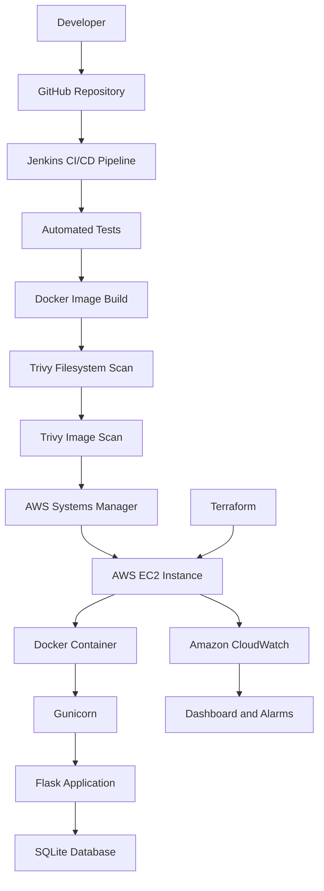

# SupplyChainX
### Supply Chain Visibility & Inventory Management Platform

SupplyChainX is a web-based supply chain management application designed to simplify inventory tracking, supplier management, purchase order processing, and shipment monitoring.

This project demonstrates the end-to-end development and deployment of a cloud-hosted application using Docker, Terraform, AWS, Jenkins CI/CD, automated testing, security scanning, and CloudWatch monitoring.

---

## 1. Features

- **Inventory Management:** Create, update, and monitor products and stock quantities.
- **Supplier Management:** Maintain supplier information and associate suppliers with products and purchase orders.
- **Purchase Order Management:** Create and manage purchase orders containing multiple items.
- **Shipment Tracking:** Track shipments and delivery statuses.
- **Low Stock Detection:** Identify products whose quantities fall below their reorder levels.
- **Dashboard:** View inventory statistics, orders, shipments, and recent activities.
- **Activity Log:** Track important application operations.
- **REST API:** Backend endpoints for application functionality and data management.
- **Health Monitoring:** Monitor application and database availability through an API endpoint.

## 2. Technology Stack

| Category | Technologies |
|---|---|
| Backend | Python, Flask |
| Database | SQLite, Flask-SQLAlchemy |
| Frontend | HTML, CSS, JavaScript |
| Testing | Pytest, pytest-cov |
| Containerization | Docker, Docker Compose |
| Application Server | Gunicorn |
| Infrastructure as Code | Terraform |
| Cloud Platform | AWS |
| Compute | Amazon EC2 |
| Remote Deployment | AWS Systems Manager |
| Monitoring | Amazon CloudWatch |
| CI/CD | Jenkins |
| Security Scanning | Trivy |
| Version Control | Git, GitHub |

## 3. System Architecture

The application uses a modular Flask backend with a browser-based frontend. It is packaged into a Docker image and deployed on an AWS EC2 instance.

Terraform provisions the AWS infrastructure. Jenkins automates testing, container builds, security scans, deployment through AWS Systems Manager, and post-deployment health verification.

Amazon CloudWatch monitors infrastructure metrics and evaluates alarms.



## 4. Project Structure

```text
SupplyChainX/
│
├── app/
│   ├── __init__.py
│   ├── routes.py
│   ├── models.py
│   ├── database.py
│   ├── templates/
│   │   └── index.html
│   └── static/
│       ├── css/
│       │   └── style.css
│       └── js/
│           └── app.js
│
├── tests/
│   ├── conftest.py
│   └── test_api.py
│
├── terraform/
│   ├── main.tf
│   ├── variables.tf
│   ├── outputs.tf
│   ├── monitoring.tf
│   └── user_data.sh
│
├── Dockerfile
├── docker-compose.yml
├── Jenkinsfile
├── requirements.txt
├── .dockerignore
├── .gitignore
└── README.md
```

## 5. Running Locally

### Prerequisites

- Python 3.12 or later
- Git
- Docker (optional)

### Clone the repository

```bash
git clone https://github.com/Heramb-Acharya/SupplyChainX.git
cd SupplyChainX
```

### Create and activate a virtual environment

Linux/macOS:

```bash
python -m venv .venv
source .venv/bin/activate
```

Windows:

```powershell
python -m venv .venv
.venv\Scripts\activate
```

### Install dependencies

```bash
pip install -r requirements.txt
```

### Start the application

```bash
flask --app "app:create_app()" run --debug
```

Open `http://127.0.0.1:5000` in your browser.

## 6. Running with Docker

Build the image:

```bash
docker build -t supplychainx .
```

Start the application:

```bash
docker compose up -d --build
```

Open `http://localhost:8000`.

Check container status:

```bash
docker compose ps
```

Check application health:

```bash
curl http://localhost:8000/api/health
```

Stop the application:

```bash
docker compose down
```

Docker Compose uses a named volume to persist the SQLite database across container restarts and recreations.

### Container Security

The Dockerfile incorporates:

- Multi-stage image construction.
- Updated Python dependencies.
- Operating-system package upgrades.
- A dedicated non-root application user.
- Gunicorn as the production WSGI server.
- Container health checks.

## 7. Automated Testing

The backend uses Pytest and pytest-cov.

Run the tests:

```bash
python -m pytest -v
```

Run tests with coverage:

```bash
python -m pytest -v --cov=app --cov-report=term
```

The current test suite contains **27 tests**, covering application functionality and API behavior.

## 8. AWS Infrastructure

SupplyChainX is deployed on Amazon EC2 in the `us-east-1` region.

| AWS Service | Purpose |
|---|---|
| Amazon EC2 | Hosts the application container |
| IAM | Provides permissions through an instance profile |
| AWS Systems Manager | Executes remote deployment commands |
| Amazon CloudWatch | Monitors infrastructure metrics and alarms |

The EC2 security group permits application access through TCP port `8000`.

Deployment uses AWS Systems Manager rather than depending on SSH access.

## 9. Infrastructure as Code – Terraform

Terraform manages the AWS infrastructure.

The configuration provisions:

- EC2 instance.
- Application security group.
- IAM instance profile attachment.
- EC2 bootstrap configuration.
- CloudWatch monitoring dashboard.
- CloudWatch metric alarms.

Initialize Terraform:

```bash
terraform -chdir=terraform init
```

Review the proposed infrastructure changes:

```bash
terraform -chdir=terraform plan
```

Apply the configuration:

```bash
terraform -chdir=terraform apply
```

View Terraform outputs:

```bash
terraform -chdir=terraform output
```

**Important:** Review the Terraform plan before applying changes. Terraform state files and plan files should not be committed to the public repository.

## 10. Jenkins CI/CD Pipeline

Jenkins automates the application delivery workflow.

The pipeline is defined in the root-level `Jenkinsfile`.

### Pipeline Stages

1. **Checkout:** Retrieves the latest source code from GitHub.
2. **Run Tests:** Executes the Pytest suite and generates coverage output.
3. **Build Docker Image:** Builds a versioned Docker image.
4. **Trivy Filesystem Scan:** Scans project files and dependencies for vulnerabilities and secrets.
5. **Trivy Docker Image Scan:** Scans the built container image for security vulnerabilities.
6. **Deploy via AWS SSM:** Deploys the application to the EC2 instance using AWS Systems Manager.
7. **Verify Live Application:** Checks the deployed application's health endpoint.

The pipeline uses the Jenkins EC2 instance's IAM role for AWS access. AWS access keys are not hardcoded in the Jenkinsfile.

## 11. Security Scanning – Trivy

Trivy is integrated into the CI/CD pipeline for automated security checks.

It performs:

- Filesystem vulnerability scanning.
- Secret detection.
- Docker image vulnerability scanning.
- HIGH and CRITICAL severity checks.

The pipeline uses scan results as a deployment gate. Vulnerability findings must be reviewed and addressed according to the configured security policy before deployment proceeds.

## 12. Monitoring – Amazon CloudWatch

CloudWatch provides infrastructure monitoring through:

- CPU utilization.
- Network traffic.
- EC2 instance status checks.
- High CPU utilization alarm.
- EC2 instance status failure alarm.
- SupplyChainX monitoring dashboard.

The dashboard provides a centralized view of the EC2 instance's operational metrics.

---
